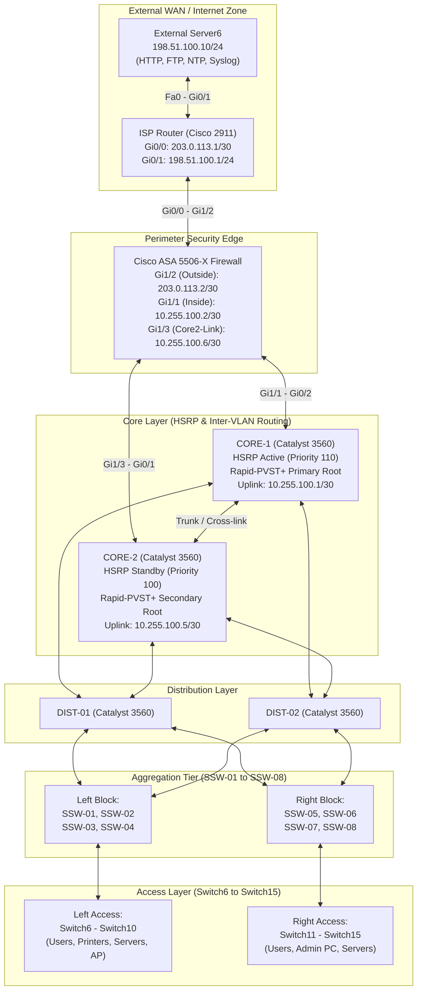

# Enterprise Campus Network Architecture & Redundancy Lab (Redundancy_ARCH)


-orange)


A comprehensive, enterprise-grade multi-tier redundant campus network architecture built and simulated in **Cisco Packet Tracer**. The network incorporates end-to-end high availability, Layer 3 gateway redundancy (HSRP), Layer 2 loop prevention and fast convergence (Rapid-PVST+), dual-homed perimeter firewall security (Cisco ASA), and centralized out-of-band management hardening.

---

## 📑 Table of Contents
1. [Network Architecture Overview](#network-architecture-overview)
2. [Topology Diagram](#topology-diagram)
3. [VLAN & IP Addressing Scheme](#vlan--ip-addressing-scheme)
4. [Routing & Gateway Redundancy (HSRP)](#routing--gateway-redundancy-hsrp)
5. [Layer 2 Switching & Spanning Tree (Rapid-PVST+)](#layer-2-switching--spanning-tree-rapid-pvst)
6. [Perimeter Security & Firewall Architecture](#perimeter-security--firewall-architecture)
7. [Management Hardening & Access Control (VLAN 99)](#management-hardening--access-control-vlan-99)
8. [Repository Structure](#repository-structure)
9. [How to Run and Verify the Lab](#how-to-run-and-verify-the-lab)

---

## 🏢 Network Architecture Overview

The campus infrastructure is engineered according to Cisco's hierarchical internetworking model to ensure scalability, fault tolerance, and deterministic traffic flow:

- **Core Layer (L3):** Two Cisco Catalyst 3560-24PS switches (`CORE-1`, `CORE-2`) providing high-speed inter-VLAN routing, core routing policies, and gateway redundancy.
- **Distribution Layer (L3/L2):** Two Cisco Catalyst 3560-24PS switches (`DIST-01`, `DIST-02`) aggregating links from lower tiers and providing redundant paths into the core.
- **Aggregation Layer (Multilayer):** Eight multilayer switches (`SSW-01` through `SSW-08`) split across dual distribution zones with redundant inter-switch links.
- **Access Layer (L2):** Ten Cisco Catalyst 2960-24TT switches (`Switch6` through `Switch15`) providing physical port connectivity for end-user workstations, printers, IP phones, wireless access points, and internal servers.
- **Perimeter Edge:** A Cisco ASA 5506-X Adaptive Security Appliance providing stateful packet inspection, network address translation (NAT/PAT), and dual-homed connectivity to the enterprise core switches.
- **WAN / Internet Edge:** A Cisco 2911 ISR simulating an ISP environment, connected to an external cloud server (`Server6`).

---

## 🗺️ Topology Diagram



---

## 📊 VLAN & IP Addressing Scheme

The internal enterprise network utilizes the private space `192.168.0.0/16`, segmented into dedicated functional subnets:

| VLAN ID | VLAN Name | Subnet | Gateway (HSRP VIP) | CORE-1 SVI | CORE-2 SVI | Description / Device Scope |
|:---:|:---|:---|:---:|:---:|:---:|:---|
| **10** | `End Devices` | `192.168.10.0/24` | `192.168.10.1` | `192.168.10.2` | `192.168.10.3` | PCs, Laptops, Printers, Access Point, Wireless Clients |
| **20** | `Servers` | `192.168.20.0/24` | `192.168.20.1` | `192.168.20.2` | `192.168.20.3` | Corporate Servers (`Server0` – `Server5`), Test workstation `PC7` |
| **30** | `Security` | `192.168.30.0/24` | `192.168.30.1` | `192.168.30.2` | `192.168.30.3` | Security devices, dedicated PCs/laptops, network printers |
| **99** | `Management` | `192.168.99.0/24` | `192.168.99.1` | `192.168.99.2` | `192.168.99.3` | Out-of-band switch SVIs, dedicated `Admin PC` (`192.168.99.50`) |

### Routed Transit & External Point-to-Point Links

| Segment | Link Endpoints | Subnet Mask | Endpoint A IP | Endpoint B IP |
|:---|:---|:---:|:---|:---|
| **Core 1 to Firewall** | CORE-1 `Gi0/2` ↔ ASA `Gi1/1` (`inside`) | `/30` (`255.255.255.252`) | `10.255.100.1` | `10.255.100.2` |
| **Core 2 to Firewall** | CORE-2 `Gi0/1` ↔ ASA `Gi1/3` (`core2-link`) | `/30` (`255.255.255.252`) | `10.255.100.5` | `10.255.100.6` |
| **Firewall to ISP** | ASA `Gi1/2` (`outside`) ↔ ISP `Gi0/0` | `/30` (`255.255.255.252`) | `203.0.113.2` | `203.0.113.1` |
| **ISP to External Server** | ISP `Gi0/1` ↔ Server6 `Fa0` | `/24` (`255.255.255.0`) | `198.51.100.1` | `198.51.100.10` |

---

## 🔄 Routing & Gateway Redundancy (HSRP)

### First Hop Redundancy Protocol (FHRP)
First-hop default gateway redundancy is handled by **Hot Standby Router Protocol (HSRP)** configured directly on the Core switches (`CORE-1` and `CORE-2`):

- **CORE-1 (Active Router):**
  - Configured with priority **110** on SVIs for VLANs 10, 20, 30, and 99.
  - Active gateway handling traffic destined outside local broadcast domains.
  - Preempt enabled to reclaim active status upon recovery.
- **CORE-2 (Standby Router):**
  - Configured with default priority **100** on SVIs for VLANs 10, 20, 30, and 99.
  - Continuously monitors hellos; assumes gateway forwarding immediately if `CORE-1` fails.

### Core Routing Architecture
- **Inter-VLAN Routing:** Performed at wire speed on `CORE-1` and `CORE-2`.
- **Default Routing to Perimeter:**
  - `CORE-1` default route: `ip route 0.0.0.0 0.0.0.0 10.255.100.2`
  - `CORE-2` default route: `ip route 0.0.0.0 0.0.0.0 10.255.100.6`
- **Firewall Return Routes:**
  - The Cisco ASA contains static return routes for internal subnets (`192.168.10.0/24`, `192.168.20.0/24`, `192.168.30.0/24`, `192.168.99.0/24`) directed to `10.255.100.1` (`CORE-1`), with floating backup routes directed to `10.255.100.5` (`CORE-2`).

---

## ⚡ Layer 2 Switching & Spanning Tree (Rapid-PVST+)

- **Spanning Tree Protocol:** **Rapid Per-VLAN Spanning Tree Plus (Rapid-PVST+)** is deployed across all switches for sub-second failover.
- **Root Bridge Placement:**
  - `CORE-1`: Primary Root Bridge (`spanning-tree vlan 10,20,30,99 root primary`)
  - `CORE-2`: Secondary Root Bridge (`spanning-tree vlan 10,20,30,99 root secondary`)
- **Trunking & Encapsulation:**
  - 802.1Q trunks configured across all Core ↔ Distribution, Distribution ↔ Aggregation, and Aggregation ↔ Access inter-switch links.
  - Explicit allowed-VLAN lists applied to prevent unnecessary broadcast flooding.

---

## 🛡️ Perimeter Security & Firewall Architecture

The network edge is protected by a **Cisco ASA 5506-X** running routed firewall mode:

### 1. Interface Security Levels
- `inside` (`Gi1/1`, Security Level 100): Connected to `CORE-1`.
- `core2-link` (`Gi1/3`, Security Level 90): Connected to `CORE-2`.
- `outside` (`Gi1/2`, Security Level 0): Connected to ISP router.

### 2. Network Address Translation (NAT)
- **Static NAT (Port Publishing / Inbound):**
  - Maps internal DMZ Server `Server0` (`192.168.20.10`) to public IP `203.0.114.10`.
  - External clients can access web services hosted on `Server0` via HTTP port 80.
- **Dynamic PAT (Outbound Overload):**
  - Translates internal private subnets (`192.168.0.0/16`) to the firewall's public outside interface (`203.0.113.2`).

### 3. Access Control Lists (ACLs)
- **Outside-to-Inside ACL:** Strictly restricts inbound traffic from the outside world, permitting only HTTP traffic targeting published servers (`203.0.114.10:80`).
- **ICMP & Inspection Policies:** Stateful packet inspection permits established return traffic while dropping unsolicited ingress packets.

---

## 🔐 Management Hardening & Access Control (VLAN 99)

The management plane is isolated on **VLAN 99** (`192.168.99.0/24`) with strict operational security controls:

- **Dedicated Admin Station:** All administrative access is centralized to `Admin PC` (`192.168.99.50`).
- **Cryptographic Access (SSHv2):**
  - Telnet is disabled globally (`transport input ssh` enforced on all VTY lines `0 4`).
  - RSA key modulus size: 1024/2048 bits.
  - Per-device administrative user accounts configured in local databases.
- **VTY Access-Class Filtering:** Standard ACL applied to line vty on every switch, permitting incoming SSH management connections **only** from source IP `192.168.99.50`. All other sources are dropped and logged.

---

## 📁 Repository Structure

```text
NetArch-Labs/
├── Redundancy_ARCH.pkt                         # Cisco Packet Tracer complete topology file
├── IP_Addressing_Plan_for_Redundancy_arch.xlsx  # 7-tab master IP addressing, cabling, and MAC inventory
└── README.md                                   # Lab documentation and architectural specification
```

### Addressing Workbook Tabs:
1. `VLAN Summary`: High-level network summary, subnet masks, wildcard masks, and HSRP VIPs.
2. `VLAN 10 - End Devices`: Port mappings, IPs, and MACs for user devices and wireless clients.
3. `VLAN 20 - Servers`: Server farm IPs, switch interfaces, and default gateways.
4. `VLAN 30 - Security`: Security infrastructure addressing and port assignments.
5. `VLAN 99 - Management`: Management SVIs, SSH hostnames, usernames, and ACL policies for all 22 switches.
6. `FW-NAT`: Firewall interface configurations, static NAT mappings, and dynamic PAT definitions.
7. `ISP & Server6`: External ISP 2911 router interfaces, static routes, and external server services.

---

## 🚀 How to Run and Verify the Lab

### Prerequisites
- **Cisco Packet Tracer v8.0 or newer** installed.

### Loading the Topology
1. Clone or download this repository:
   ```bash
   git clone https://github.com/Akki-74/NetArch-Labs.git
   ```
2. Open `Redundancy_ARCH.pkt` in Cisco Packet Tracer.
3. Allow 30–45 seconds for Rapid-PVST+ to converge (all link lights turn green).

### Verification Commands & Tests

#### 1. Verify HSRP State on Core Switches
On `CORE-1` (expected Active) and `CORE-2` (expected Standby):
```cisco
show standby brief
show standby vlan 10
```

#### 2. Verify Spanning Tree Topology
```cisco
show spanning-tree summary
show spanning-tree vlan 10
```

#### 3. Test Outbound Connectivity
From any workstation in VLAN 10 (e.g., `PC0` `192.168.10.10`):
```cmd
ping 192.168.10.1       :: Ping HSRP Gateway
ping 10.255.100.2       :: Ping ASA Inside Interface
ping 198.51.100.10      :: Ping External Internet Server6
```

#### 4. Test Inbound Web Server Access
From external `Server6` or ISP command prompt, test HTTP access to published internal server:
- Open web browser on `Server6` and navigate to: `http://203.0.114.10`

#### 5. Verify SSH Management Restrictions
From `Admin PC` (`192.168.99.50`):
```cmd
ssh -l netadmin 192.168.99.1
```
*(Connections from workstations on VLAN 10, 20, or 30 will be rejected by the VTY access-list).*

---

## 👨‍💻 Author & Contributions
- **Repository:** [Akki-74/NetArch-Labs](https://github.com/Akki-74/NetArch-Labs)
- Built for enterprise network redundancy testing, security perimeter verification, and CCNA/CCNP architecture demonstrations.
